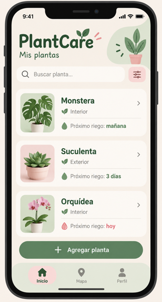
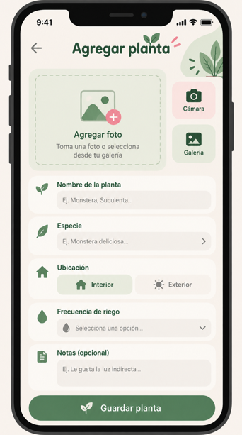
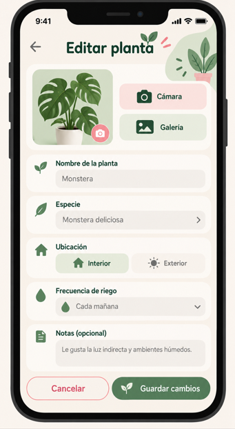
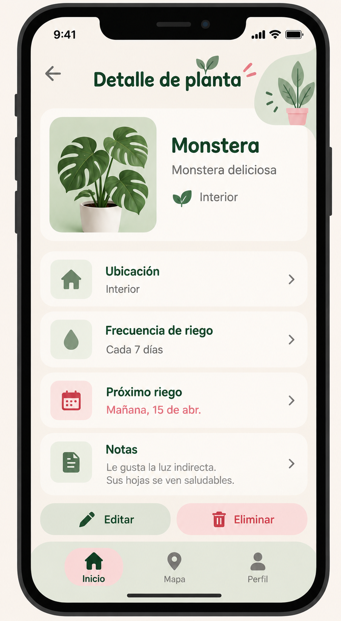
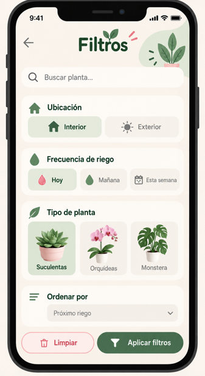
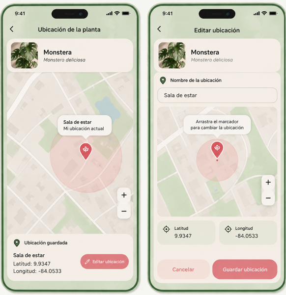

# Integrante
Alison Viviana Rojas Mora

# Descripción del proyecto

PlantCare es una aplicación móvil que tiene como objetivo ayudar a las personas a llevar un mejor control del cuidado de sus plantas. Permitirá registrar las plantas que tienen en casa, almacenar información importante sobre ellas y organizar sus cuidados de una manera sencilla.

La idea es que los usuarios puedan consultar la información de sus plantas, llevar un seguimiento de sus riegos y tener un espacio donde puedan administrar todas sus plantas desde su dispositivo móvil.

Funcionalidades principales

Registro de plantas (CRUD): permitirá agregar, consultar, editar y eliminar plantas, incluyendo datos como nombre, especie, frecuencia de riego y descripción.

Lista con filtros personalizados: mostrará las plantas registradas y permitirá buscarlas por nombre, especie o necesidad de riego.

Cámara y galería: permitirá tomar fotografías o seleccionar imágenes de la galería para agregarlas al registro de cada planta.

Diálogos de confirmación: se utilizarán para confirmar acciones importantes, como eliminar una planta.

Mapa: permitirá registrar y visualizar la ubicación de las plantas mediante un mapa.

Control de riego: permitirá consultar cuándo corresponde realizar el próximo riego de cada planta.

# Mockups

En esta sección se agregarán los diseños de las pantallas que tendrá la aplicación, considerando una interfaz sencilla, intuitiva y fácil de utilizar.

Pantallas previstas:

### Pantalla principal con la lista de plantas

### Pantalla para registrar una planta

### Pantalla para editar una planta

### Pantalla para consultar una planta

### Pantalla con filtros de búsqueda

### Pantalla de mapa

